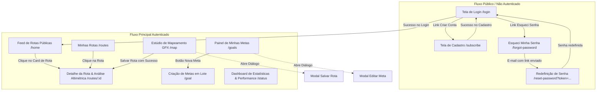

# Arquitetura Funcional e Estrutura de Informação do Frontend (Tracker)

Este documento mapeia integralmente o ecossistema frontend da aplicação **Tracker**, abstraindo estilizações visuais ou componentes específicos de framework (como Angular Material). Ele serve como base arquitetural e funcional definitiva para alimentar o processo de design system e prototipação de alta fidelidade no **Google Stitch**.

---

## 1. Propósito da Aplicação e Perfis de Usuário

### 1.1 Propósito
O **Tracker** é uma plataforma voltada para ciclistas e atletas de endurance (amadores a experientes) para gravação, visualização analítica, compartilhamento e gerenciamento de trilhas e rotas a partir de telemetria geográfica (arquivos `.gpx`). A aplicação permite inspecionar percursos em mapas vetoriais interativos, analisar curvas de elevação e altimetria acumulada, fixar metas de desempenho periódico (distância, ganho de elevação, pedaladas, tempo), acompanhar estatísticas de evolução e explorar percursos comunitários públicos filtrados geograficamente com moderação automatizada de fotos de atividades.

### 1.2 Perfis de Usuário
1. **Atleta / Ciclista Não Autenticado (Visitante)**:
   - Acessa telas de autenticação e recuperação de credenciais.
   - Pode criar nova conta informando dados pessoais, biométricos e tipo sanguíneo (dados de emergência médica para esportes de aventura).
2. **Ciclista Ativo (Usuário Autenticado)**:
   - **Explorador:** Navega pelo feed de rotas públicas da comunidade, filtra por raio geográfico a partir da sua posição GPS atual.
   - **Navegador & Mapeador:** Importa e pré-visualiza múltiplos arquivos `.gpx`, inspeciona o perfil altimétrico ponto a ponto, analisa coordenadas e salva percursos na nuvem vinculando país, visibilidade e fotos moderadas por IA.
   - **Atleta em Treinamento:** Acompanha dashboards com KPIs de quilometragem e altimetria total, visualiza histórico de treinos recentes e gerencia metas com barras de progresso percentual e contagem regressiva de prazos.
   - **Gerenciador de Atividades:** Controla privacidade (pública vs. privada), faz download de arquivos `.gpx` gravados e exclui percursos.

---

## 2. Mapa de Navegação e Fluxo de Telas

### Barra de Navegação Global (TopBar):
- **Logo / Brand**: Direciona para `/home` (ou `/login` quando deslogado).
- **Home**: Feed comunitário de percursos (`/home`).
- **Menu Mapas**:
  - *Visualizar Rota / Estúdio de Mapeamento*: Importação e inspeção GPX (`/map`).
  - *Minhas Rotas*: Lista de trajetos criados pelo usuário (`/routes`).
- **Menu Status & Metas**:
  - *Minhas Metas*: Acompanhamento de metas ativas (`/goals`).
  - *Criar Metas*: Formulário de novos objetivos (`/goal`).
  - *Estatísticas*: Métricas globais consolidadas e gráficos (`/status`).
- **Área do Usuário**:
  - Botão de Perfil (`/profile`).
  - Ação de Sair (`Logout`).
  - *Quando deslogado:* Botão de destaque "Inscrever-se gratuitamente".

---

## 3. Estrutura Funcional e Detalhamento das Telas

---

### 3.1 Tela de Autenticação (`/login`)
- **Propósito:** Ponto de entrada de credenciais para obtenção de token JWT e liberação da sessão.
- **Hierarquia de Importância:**
  1. *Alta:* Campos de credencial (E-mail e Senha com alternância de visibilidade) e botão de submissão ("Entrar").
  2. *Média:* Ação de recuperação de conta ("Esqueci minha senha").
  3. *Baixa:* Ação secundária para novos usuários ("Criar conta").
- **Dados Exibidos:** Mensagens de erro de autenticação (credenciais inválidas ou erro de conectividade).
- **Ações do Usuário:**
  - Digitar e-mail e senha.
  - Alternar visualização da senha (ocultar/mostrar caracteres).
  - Submeter login.
  - Navegar para criar conta (`/subscribe`) ou redefinir senha (`/forgot-password`).

---

### 3.2 Tela de Cadastro de Usuário (`/subscribe`)
- **Propósito:** Registro completo de novo atleta, coletando dados essenciais de treino e saúde física.
- **Hierarquia de Importância:**
  1. *Alta:* Identificação e segurança (Nome completo, E-mail, Senha com requisitos de complexidade e Confirmação de senha).
  2. *Alta:* Dados biométricos e clínicos do atleta (Idade, Peso em kg, Data de nascimento, Tipo Sanguíneo: A+, A-, B+, B-, AB+, AB-, O+, O-).
  3. *Média:* Botão de finalização de cadastro e feedback modal de sucesso.
  4. *Baixa:* Atalho para login para quem já possui conta.
- **Dados Exibidos:** Validações de regex de senha (mínimo 8 caracteres, letra maiúscula e número), validações de data de nascimento passada, seletores de tipo sanguíneo.
- **Ações do Usuário:**
  - Preenchimento do formulário reativo.
  - Submissão com abertura de modal de boas-vindas.
  - Redirecionamento para login.

---

### 3.3 Recuperação e Redefinição de Senha (`/forgot-password` e `/reset-password`)
- **Propósito:** Solicitação de link seguro por e-mail e posterior troca de senha utilizando token temporário.
- **Hierarquia de Importância:**
  1. *Alta:* Campo de e-mail (em `/forgot-password`) ou nova senha + confirmação (em `/reset-password`).
  2. *Alta:* Estados de feedback e segurança (mensagens de link expirado, token já utilizado ou confirmação de sucesso).
  3. *Baixa:* Retorno à tela de login.
- **Dados Exibidos:** Estado de e-mail enviado, alertas de link inválido/expirado, confirmação de senha redefinida.
- **Ações do Usuário:**
  - Enviar e-mail de recuperação.
  - Definir nova senha combinando requisitos de segurança.

---

### 3.4 Feed de Rotas Públicas — Home (`/home`)
- **Propósito:** Descoberta comunitária de trilhas e trajetos compartilhados por outros ciclistas.
- **Hierarquia de Importância:**
  1. *Alta:* Lista/grid de cards de rotas com indicadores-chave (Distância em km, Elevação acumulada em m, Nome da rota, Autor e Cidade/País).
  2. *Média:* Barra de controle de geolocalização e raio (botão "Usar minha localização", seletor de raio de busca em slider de 5 a 100 km, remoção do filtro geográfico).
  3. *Média:* Paginação do catálogo de rotas.
  4. *Baixa:* Estados de tela vazia ("Nenhuma rota encontrada") e estados de carregamento.
- **Dados Exibidos:**
  - Título, subtítulo e indicador de filtro ativo.
  - Para cada card de rota: nome da rota, data/hora da atividade, autor, cidade/país, tag de dificuldade (`EASY`, `MODERATE`, `HARD`, `EXPERT`), distância (km) e ganho de altitude (m).
- **Ações do Usuário:**
  - Clicar em um card de rota para abrir detalhes completos (`/routes/:id`).
  - Habilitar filtro de proximidade GPS e ajustar raio de busca.
  - Navegar entre páginas da listagem.

---

### 3.5 Estúdio de Mapeamento & Importação GPX (`/map`)
- **Propósito:** O núcleo interativo do aplicativo para engenharia de rotas: carga de arquivos GPX brutos do GPS, análise visual no mapa, inspeção altimétrica e envio para a nuvem.
- **Hierarquia de Importância:**
  1. *Alta:* Mapa interativo em tela cheia com traçado vetorial estilizado em cores distintas para cada rota carregada.
  2. *Alta:* Painel de elevação dinâmico sincronizado: gráfico de altimetria interativo onde passar o mouse na curva move o marcador exato sobre o mapa.
  3. *Alta:* Barra de ferramentas flutuante de ações rápidas: Centralizar na minha localização GPS, Carregar arquivos GPX (`.gpx`), Salvar rota ativa e Limpar mapa.
  4. *Média:* Painel lateral retrátil (Sidebar de Camadas) com árvore hierárquica de percursos carregados, alternância de visibilidade por checkbox, cores identificadoras e botão individual de salvar.
  5. *Média:* Indicador consolidado da rota ativa: número de pontos de telemetria, distância total em km e ganho total de elevação (m).
- **Dados Exibidos:**
  - Traçado espacial georreferenciado (Leaflet).
  - Estatísticas do arquivo ativo: Nome, Pontos analisados, Distância (km), Elevação (m).
  - Curva de perfil topográfico (distância x altitude).
- **Ações do Usuário:**
  - Selecionar um ou múltiplos arquivos `.gpx` do disco.
  - Alternar entre rotas na árvore lateral.
  - Inspecionar relevo movendo o cursor no gráfico.
  - Disparar o fluxo de salvamento (abre o modal `SaveRouteDialogComponent`).
  - Limpar percursos do mapa.

---

### 3.6 Modal de Salvamento de Rota (`SaveRouteDialogComponent`)
- **Propósito:** Configurar metadados, visibilidade e mídia da rota antes de persistir no banco PostGIS.
- **Hierarquia de Importância:**
  1. *Alta:* Identificação e parâmetros da rota: Nome da rota (obrigatório, máx 80 caracteres), País (seleção com bandeira) e Visibilidade (Alternador Pública vs. Privada).
  2. *Alta:* Resumo em destaque das métricas imutáveis da rota (Distância total em km e Ganho de elevação em m).
  3. *Média:* Upload de imagens da atividade com arrastar-e-soltar (drag & drop), pré-visualização em miniatura, botão de remoção e status de validação de imagem por IA (NSFW).
  4. *Baixa:* Ações de confirmação ("Salvar Rota") e cancelamento.
- **Dados Exibidos:** Distância e elevação calculadas, prévias das fotos com spinner de análise de moderação em tempo real, lista de países.
- **Ações do Usuário:**
  - Editar o nome final da trilha.
  - Definir se a rota será pública na comunidade ou privada.
  - Anexar fotos via explorador de arquivos ou drag-and-drop.
  - Submeter salvamento na nuvem.

---

### 3.7 Gerenciador de Minhas Rotas (`/routes`)
- **Propósito:** Lista de controle pessoal e governança de todos os percursos gravados pelo atleta autenticado.
- **Hierarquia de Importância:**
  1. *Alta:* Lista de cards de rota exibindo: Nome clicável, data da atividade, distância (km) e altimetria (m).
  2. *Alta:* Controle rápido de privacidade via chip/toggle com clique direto (alternar instantaneamente entre Privada e Pública).
  3. *Média:* Menu de contexto (`...`) com ações explícitas: Ver detalhes e Excluir rota (com confirmação).
  4. *Média:* Contador total de rotas e barra de paginação (tamanhos de página 5, 10, 20).
  5. *Baixa:* Estado vazio com incentivo à gravação.
- **Dados Exibidos:** Lista paginada de rotas do usuário, badge de status de visibilidade (ícone de cadeado/globo), data formatada.
- **Ações do Usuário:**
  - Clicar no título da rota para ver detalhes.
  - Alternar a visibilidade de uma rota com 1 clique.
  - Excluir rota individualmente.
  - Trocar de página e alterar densidade de itens.

---

### 3.8 Detalhes Analíticos da Rota (`/routes/:id`)
- **Propósito:** Visão aprofundada de um trajeto específico, combinando telemetria geográfica, gráficos de elevação, galeria de fotos e download GPX.
- **Hierarquia de Importância:**
  1. *Alta:* Cabeçalho executivo: Nome da rota, autor, localização (Cidade, País), data de gravação, chip de visibilidade e botão primário de exportação ("Baixar GPX").
  2. *Alta:* Painel de métricas analíticas (Distância percorrida, Elevação acumulada e Elevação média).
  3. *Alta:* Mapa interativo da rota com renderização de rota completa e marcador sincronizado de posição.
  4. *Alta:* Gráfico de altimetria completo (Chart.js): curva de altitude ao longo da quilometragem com hover bidirecional conectado ao mapa.
  5. *Média:* Galeria de fotos associadas à rota com clique para visualização em lightbox/zoom.
  6. *Baixa:* Ações administrativas secundárias (excluir rota no menu `...`).
- **Dados Exibidos:** Metadados da rota, array de pontos de replay (`latitude`, `longitude`, `altitudeInMeters`, `recordedAt`), fotos recuperadas via URLs pré-assinadas (MinIO), estatísticas de relevo.
- **Ações do Usuário:**
  - Exportar/Baixar arquivo `.gpx` reconstruído.
  - Interagir com o gráfico de elevação e observar a posição correspondente no mapa.
  - Ampliar fotos no Lightbox.
  - Alternar privacidade ou excluir o registro.

---

### 3.9 Painel de Metas do Atleta (`/goals`)
- **Propósito:** Acompanhamento do progresso das metas físicas estabelecidas pelo ciclista.
- **Hierarquia de Importância:**
  1. *Alta:* Barra de progresso visual de cada meta (valor atual vs. valor alvo + porcentagem concluída, mudando de estado visual ao atingir 100%).
  2. *Alta:* Nome, descrição do desafio e identificador de unidade (km, rides, horas, metros de elevação).
  3. *Média:* Prazo limite com destaque de alerta visual para metas expiradas.
  4. *Média:* Ações em linha por item: Editar parâmetros da meta (modal) e Excluir meta.
  5. *Média:* Ação de cabeçalho "Nova meta" direcionando para `/goal`.
- **Dados Exibidos:** Tabela/cards de metas com: Nome, Descrição, Valor Alvo, Valor Atual, % de Progresso, Unidade, Data de Prazo (`dd/MM/yyyy`).
- **Ações do Usuário:**
  - Acompanhar % concluído.
  - Abrir diálogo de edição rápida de valores e prazos.
  - Excluir meta.
  - Navegar para criação de novas metas.

---

### 3.10 Criação de Metas em Lote (`/goal`)
- **Propósito:** Definição flexível de objetivos esportivos com suporte à criação múltipla simultânea no mesmo fluxo.
- **Hierarquia de Importância:**
  1. *Alta:* Formulário dinâmico por meta:
     - Nome da meta (máx 100 caracteres).
     - Valor alvo (numérico > 0).
     - Unidade de medida (Quilômetros `km`, Pedaladas `rides`, Horas `horas`, Metros de elevação `metros`).
     - Prazo limite (seletor de data a partir da data de hoje).
     - Descrição detalhada do objetivo.
  2. *Média:* Ação "Adicionar outra meta" (acrescenta novo bloco de formulário dinamicamente) e botão de remoção individual de blocos.
  3. *Média:* Botão de submissão global ("Salvar Metas") com validação integrada de todos os blocos.
  4. *Baixa:* Atalho para voltar ao painel de metas (`/goals`).
- **Dados Exibidos:** Lista dinâmica de cartões de rascunho de metas com contadores sequenciais ("Meta 1", "Meta 2", ...).
- **Ações do Usuário:**
  - Preencher múltiplos cartões de metas de uma só vez.
  - Adicionar ou remover metas antes do envio.
  - Submeter todas as metas em lote via API (`POST /api/goal`).

---

### 3.11 Dashboard de Estatísticas & Performance (`/status`)
- **Propósito:** Centro analítico consolidado do ciclista com métricas de carreira acumuladas, histórico recente e metas ativas.
- **Hierarquia de Importância:**
  1. *Alta:* Banner de engajamento do atleta com mensagem adaptativa baseada no volume de treinos (0 rotas, 1 rota ou N rotas registradas).
  2. *Alta:* KPIs agregados de desempenho geral: Distância Total (km) e Elevação Total Acumulada (m).
  3. *Média:* Resumo das metas ativas em andamento com barras de progresso percentual ordenadas pelas mais próximas da conclusão.
  4. *Média:* Feed de "Últimas rotas" (distância, ganho de altitude e data da atividade).
  5. *Média (Opcional/Expansível):* Gráfico de barras com a evolução da distância percorrida nos últimos 7 dias.
- **Dados Exibidos:** `totalDistanceKm`, `totalElevationMeters`, `totalRides`, `recentRides` (últimas pedaladas), `activeGoals` (metas em andamento ordenadas por progresso) e `weeklyChart` (distância diária dos últimos 7 dias).
- **Ações do Usuário:**
  - Consulta executiva de progresso e ritmo de evolução.
  - Acesso aos atalhos de rotas e metas.

---

## 4. Diretrizes para o Redesign no Google Stitch

Para a etapa de prototipação no **Google Stitch**, utilize as seguintes premissas conceituais extraídas desta arquitetura:

1. **Foco em Dados de Telemetria e Esporte:**
   - As métricas de *Distância*, *Altimetria/Ganho de Elevação* e *Curva de Relevo* são as informações de maior peso visual na aplicação. Devem ter tipografia numérica robusta e legível (tabular figures).
2. **Ambiente Espacial e Cartográfico Imersivo:**
   - A tela de Mapeamento (`/map`) e a tela de Detalhes (`/routes/:id`) devem priorizar visibilidade ampla do mapa com elementos de controle flutuantes e painéis contextuais translúcidos ou acopláveis (estilo HUD esportivo moderno).
3. **Sincronia Interativa Mapa-Gráfico:**
   - O gráfico de elevação precisa de representação clara de cursor com ponteiro correspondente projetado no traçado do mapa.
4. **Governança de Privacidade Evidente:**
   - A distinção entre trilhas Públicas e Privadas deve ser comunicada por estados visuais contrastantes (ícones e badges semânticos).
5. **Formulários Estruturados para o Atleta:**
   - A inclusão de campos como tipo sanguíneo no cadastro e unidades esportivas nas metas (`km`, `altimetria`, `rides`, `horas`) reforça a identidade de app especializado em ciclismo/outdoor.
